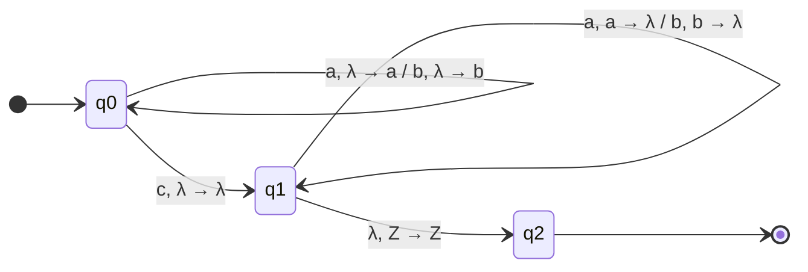
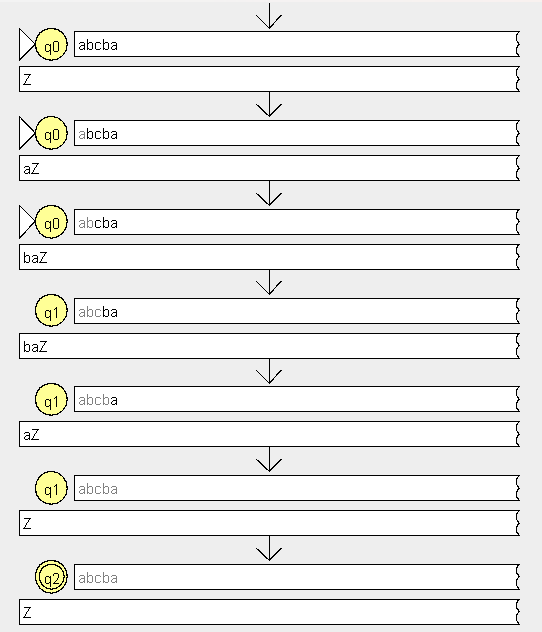
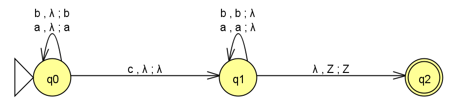
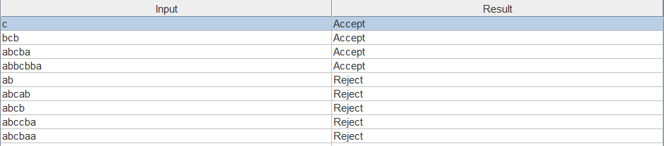
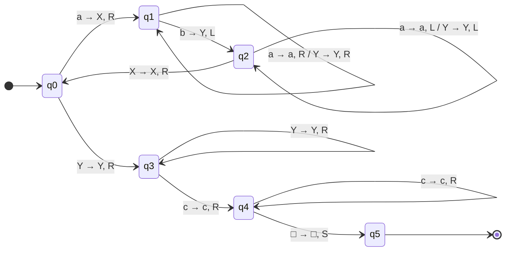
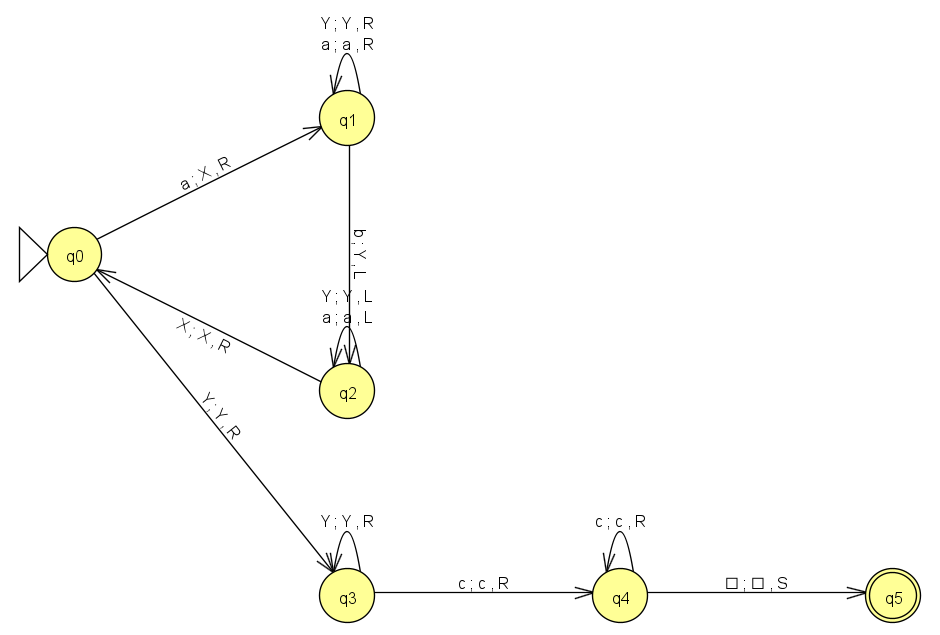
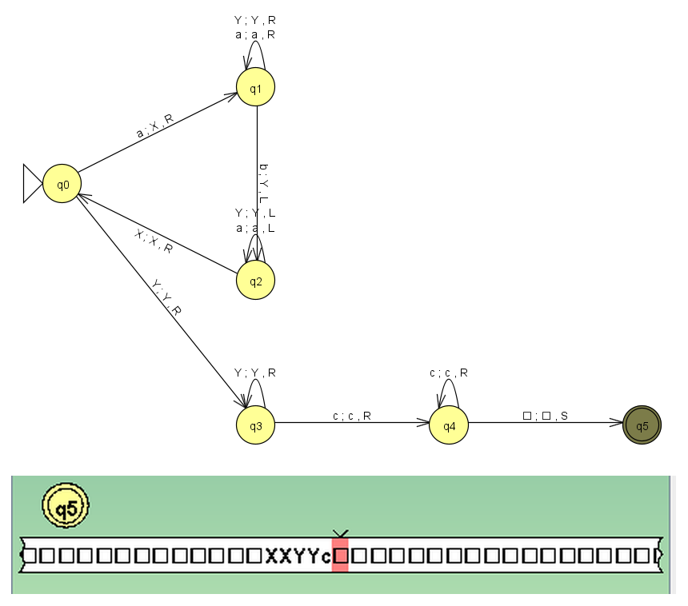
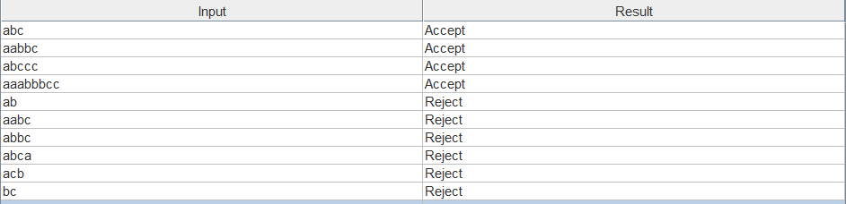
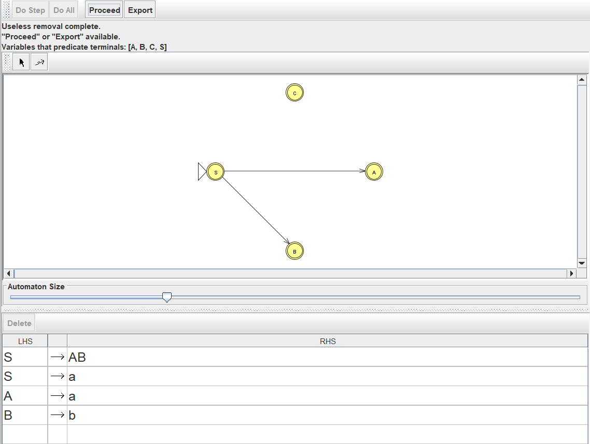
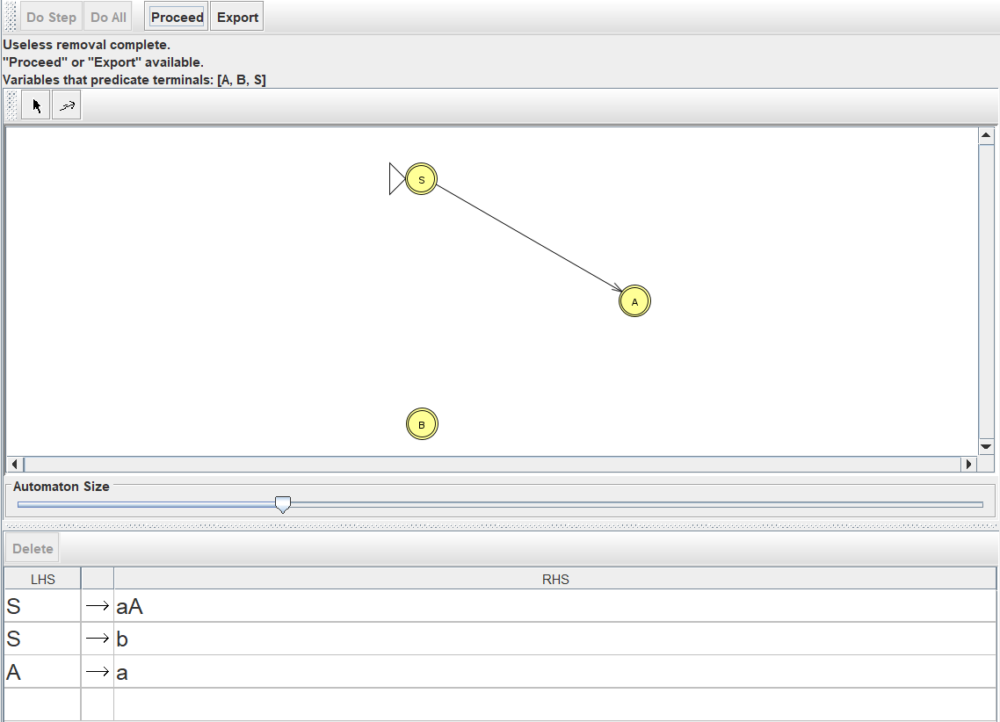

<div align="center">

# Formal Languages &amp; Automata — JFLAP Practical

**Pushdown Automata · Turing Machines · Context-Free Grammar Simplification**

*21CSC301T · SRM Institute of Science and Technology · Set 43*

<br>


<br>

[**Read the report (PDF)**](report/Set43_JFLAP_Report_RA2411026011163.pdf) &nbsp;·&nbsp;
[JFLAP files](jflap/) &nbsp;·&nbsp;
[Screenshots](screenshots/) &nbsp;·&nbsp;
[Answer notes](docs/answers.md)

</div>

---

## Overview

Four problems from Units 3–5 of *Formal Language and Automata*. Each one was designed by hand, built in **JFLAP 7.1**, and checked in JFLAP's simulator against strings that should be accepted and strings that should be rejected. Every result matches the expected outcome.

| # | Unit | Problem | Model | Result |
|:-:|:-:|---|---|:-:|
| [1](#1--pda-for-w-c-wᴿ) | 4 | PDA for **{ w c wᴿ \| w ∈ {a,b}\* }**, trace `abcba` | Deterministic PDA | 9 / 9 tests |
| [2](#2--turing-machine-deciding-aⁿbⁿcᵐ) | 5 | TM deciding **{ aⁿ bⁿ cᵐ \| n, m ≥ 1 }** | Single-tape TM | 10 / 10 tests |
| [3](#3--removal-of-useless-symbols) | 3 | Remove useless symbols | Generating + reachability | C removed |
| [4](#4--removal-of-inaccessible-symbols) | 3 | Remove inaccessible symbols | Dependency graph | B removed |

---

## 1 · PDA for w c wᴿ

> Construct a PDA for *L = { w c wᴿ | w ∈ {a,b}\* }*, then trace `abcba`.

The left half is pushed onto the stack. The centre marker `c` switches the machine into matching mode, and the stack's last-in-first-out order hands the symbols back reversed. Because `c` marks the middle, the machine never has to guess, so the PDA is **deterministic**.



<sub>Transition label `x, y → z`: read x, pop y, push z. Acceptance by final state q2.</sub>

<table>
<tr>
<td width="58%" valign="top">

**Trace of `abcba`**

| Step | State | Unread | Stack | Move |
|:-:|:-:|---|---|---|
| 0 | q0 | `abcba` | `Z` | start |
| 1 | q0 | `bcba` | `aZ` | push a |
| 2 | q0 | `cba` | `baZ` | push b |
| 3 | q1 | `ba` | `baZ` | read c |
| 4 | q1 | `a` | `aZ` | pop b |
| 5 | q1 | λ | `Z` | pop a |
| 6 | **q2** | λ | `Z` | **accept** |

</td>
<td width="42%" valign="top" align="center">
<br>
<sub>JFLAP traceback for <code>abcba</code></sub>
</td>
</tr>
</table>

<details>
<summary><b>JFLAP diagram and test results</b></summary>
<br>

<br><br>

| Accepted | Rejected |
|---|---|
| `c` · `bcb` · `abcba` · `abbcbba` | `ab` · `abcab` · `abcb` · `abccba` · `abcbaa` |


</details>

---

## 2 · Turing Machine deciding aⁿbⁿcᵐ

> Construct a single-tape TM deciding *L = { aⁿ bⁿ cᵐ | n, m ≥ 1 }*.

**Mark and match.** The machine repeatedly turns the leftmost `a` into `X` and the first unmarked `b` into `Y`. When no `a` is left, it checks that only `Y`s remain before the `c`s, that there is at least one `c`, and that the input ends there. Every round marks two symbols for good, so the machine **always halts** and uses O(n²) moves.



<sub>Transition label `x → y, D`: read x, write y, move the head D. A missing transition halts and rejects.</sub>

**Trace of `aabbc`** (14 moves)

```
q0aabbc ⊢ Xq1abbc ⊢ Xaq1bbc ⊢ Xq2aYbc ⊢ q2XaYbc ⊢ Xq0aYbc ⊢ XXq1Ybc ⊢ XXYq1bc
        ⊢ XXq2YYc ⊢ Xq2XYYc ⊢ XXq0YYc ⊢ XXYq3Yc ⊢ XXYYq3c ⊢ XXYYcq4□ ⊢ XXYYcq5□   accept
```

<details>
<summary><b>JFLAP diagram, accepting run and test results</b></summary>
<br>
<p align="center">

&nbsp;

</p>

| Accepted | Rejected |
|---|---|
| `abc` · `aabbc` · `abccc` · `aaabbbcc` | `ab` · `aabc` · `abbc` · `abca` · `acb` · `bc` |


</details>

---

## 3 · Removal of useless symbols

> Remove useless symbols from *S → AB | a, A → a, B → b, C → cC | c*.

A symbol is useful only if it takes part in deriving some terminal string. Remove non-generating symbols first, then unreachable ones. The order matters, because the first step can make more symbols unreachable.

| Phase | Result |
|---|---|
| Generating variables | { S, A, B, C } — all generate, nothing removed |
| Reachable from S | { S, A, B } — **C is never reached** |

<table>
<tr>
<td width="50%" valign="top">

**Before**
```
S → AB | a
A → a
B → b
C → cC | c
```

**After**
```
S → AB | a
A → a
B → b
```
L(G) = L(G′) = { a, ab }

</td>
<td width="50%" valign="top" align="center">
<br>
<sub>JFLAP dependency graph: C has no incoming edge</sub>
</td>
</tr>
</table>

---

## 4 · Removal of inaccessible symbols

> Remove inaccessible symbols from *S → aA | b, A → a, B → bB | b*.

Draw the dependency graph and keep only what can be reached from S. The edges are S → A and B → B, so starting from S reaches only { S, A }. B can still generate `b`, but nothing ever leads to it, so it is **inaccessible**.

<table>
<tr>
<td width="50%" valign="top">

**Before**
```
S → aA | b
A → a
B → bB | b
```

**After**
```
S → aA | b
A → a
```
L(G) = L(G′) = { aa, b }

</td>
<td width="50%" valign="top" align="center">
<br>
<sub>JFLAP dependency graph: B is isolated from S</sub>
</td>
</tr>
</table>

---

## Repository layout

```
├── report/        Full report (PDF): definitions, traces, test tables, figures
├── jflap/         JFLAP 7.1 machine and grammar files (.jff)
├── screenshots/   21 raw JFLAP screenshots from the simulation runs
├── docs/          Plain-text answer notes
└── assets/        Figures used in this README
```

## Run it yourself

1. Install a Java runtime (JDK 8 or newer).
2. Download [JFLAP 7.1](https://www.jflap.org/jflaptmp/).
3. Open any file from [`jflap/`](jflap/):
   ```bash
   java -jar JFLAP7.1.jar jflap/Q1_PDA_wcwR.jff
   ```
4. For the PDA and TM, use **Input → Step** for a trace or **Input → Multiple Run** for batch tests. For the grammars, use **Convert → Transform Grammar**.

---

<div align="center">
<sub><b>Venkatanathan O R V</b> · B.Tech CSE (AIML) · SRM Institute of Science and Technology<br>
Course faculty: Dr. Sreekrishna M</sub>
</div>
